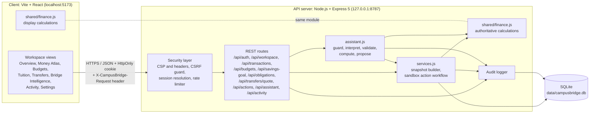
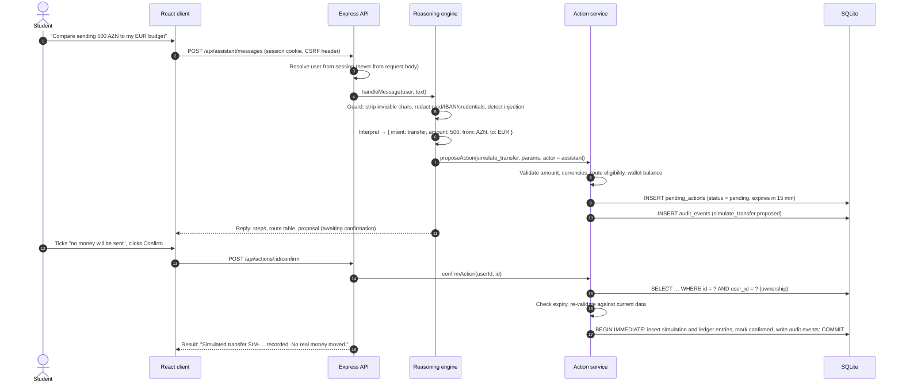

# Technical Documentation & Security Self-Assessment Report: CampusBridge AI

| Field | Detail |
| --- | --- |
| Competition | 2026 Shenzhen International FinTech Competition (FinTechathon), International Track |
| Selected topic | Topic C, Cross-border & Student Finance Assistant |
| Project | CampusBridge AI |
| Team | Eltek |
| Institution | Azerbaijan Technical University |
| Team lead | Rafael Gurbanov |
| Repository | https://github.com/RafaelGurbanov/China-Hack |
| Document type | Technical documentation and security self-assessment |
| Build status | Working sandbox prototype: 42/42 automated tests passing, 55/55 browser checks at six viewport widths, 0 known dependency vulnerabilities (`npm audit`) |

| Team member | Role |
| --- | --- |
| Rafael Gurbanov (Team Lead) | Full-stack developer |
| Ayan Mahmudova | UX/UI designer |
| Nabiyeva Gulustan | Full-stack developer |
| Elgun Shukurov | AI/ML engineer |

> **Scope statement.** CampusBridge AI is a demonstration prototype. Exchange rates are an illustrative fixed table, transfer routes are fictional archetypes, and every transfer is a sandbox simulation that moves no money. The system is not a bank, payment institution or credit provider and gives no financial advice. This report describes the system as implemented in the repository and distinguishes clearly between implemented controls and planned extensions.

---

## 1. Executive Summary & Problem Statement

### 1.1 Executive summary

CampusBridge AI is an intelligent financial workspace and task agent for international students. It brings five capabilities together in one authenticated web application:

1. **Multi-currency budgeting:** a ledger of income and expenses in six currencies (AZN, EUR, USD, GBP, TRY, CNY), category budgets and recurring obligations.
2. **Tuition savings planning:** required monthly contribution, projected completion date and schedule status against a payment deadline.
3. **Cross-border transfer comparison:** a transparent fee and exchange-margin breakdown across four simulated route archetypes, ranked by the student's priority.
4. **Money Atlas:** an interactive corridor map (Baku to Berlin, London, Istanbul, Beijing and New York) that prices every corridor and shows the student's simulation history.
5. **Bridge Intelligence:** a task agent that interprets a request, validates it, calculates with the student's stored data, proposes a consequential action, and executes it in the sandbox **only after explicit confirmation**, recording every step in an audit trail.

The reference scenario is a fictional Azerbaijani student in Germany. Family support arrives in AZN, while rent, insurance and tuition are paid in EUR.

### 1.2 Problem statement

International students operate across two financial systems with little tooling designed for them:

| Problem | Consequence for the student |
| --- | --- |
| **Fragmented multi-currency position** | Balances, spending and savings sit in different currencies, so the student cannot see what is actually available this month. |
| **Opaque transfer pricing** | The visible fee is only part of the cost. The exchange-rate margin is embedded in the rate. In our illustrative data, the same 500 AZN delivers 268.21 EUR through the cheapest route and 248.69 EUR through the bank-wire archetype: a 19.52 EUR (7.8%) difference. |
| **Unplanned tuition liabilities** | Semester fees require months of saving. Without a required-pace calculation, shortfalls become visible only near the deadline. |
| **Low financial literacy in a new jurisdiction** | Students rarely know how budgeting, transfers or credit history work in the host country, and they are vulnerable to unsafe "guaranteed" offers. |
| **Risk of unsafe automation** | An assistant that can act on money must never act without authorisation or invent figures. |

### 1.3 Alignment with Topic C requirements

| Topic C requirement | CampusBridge AI implementation | Location in repository |
| --- | --- | --- |
| Plan tuition payments | Savings plan with required monthly contribution, projected completion and status | `shared/finance.js` → `savingsPlan()` |
| Compare cross-border transfers | Four route archetypes with fee, margin, rate, delivery and recipient amount; four ranking priorities | `shared/finance.js` → `quoteRoute()`, `pickBest()`, `compareTransfer()` |
| Manage multi-currency budgets | Wallet ledger in six currencies, category limits, monthly utilisation, transaction filters | `shared/finance.js` → `walletBalances()`, `monthlySpending()` |
| Credit-building basics | Educational guidance with explicit "no guarantee" disclosures | `server/assistant.js` → `credit()` |
| Agent that acts as a financial participant | Propose, confirm, re-validate, execute and record workflow with server-side enforcement | `server/services.js`, `server/assistant.js` |
| Safety and transparency | Illustrative and simulated labelling on every surface, confirmation gates, audit log, redaction of sensitive data | Whole system (Section 3) |

---

## 2. System Architectural Design & Core Algorithms

### 2.1 Architecture overview

CampusBridge AI is a three-tier application with a strict separation between presentation, business logic and persistence.

| Tier | Technology (exact version) | Responsibility |
| --- | --- | --- |
| **Client** | React 19.3.1, Vite 8.3.4, Tailwind CSS 4.3.3, React Router 8.4.0, custom SVG visualisations | Rendering, form input, interaction state. Holds **no authoritative financial data** and no secrets. All state is fetched from the API. |
| **API server** | Node.js (22.13 or newer), Express 5.3.0 | Authentication, authorisation, validation, business logic, sandbox action workflow, audit logging, security headers |
| **Shared calculation core** | `shared/finance.js` (pure ES module) | Every financial formula, used by the server as the source of truth and by the client for display. No I/O. |
| **Reasoning engine** | `server/assistant.js` (deterministic rules engine; optional Claude interpreter via the Anthropic Messages API) | Guarding, intent interpretation, validation, calculation and proposal of actions |
| **Persistence** | SQLite through Node's built-in `node:sqlite`, file `data/campusbridge.db` | Users, sessions, profiles, ledger, budgets, goals, obligations, simulations, pending actions, assistant messages, audit events |

**Development topology:** the Vite development server (`http://localhost:5173`) serves the client and proxies `/api/*` to the Express server (`http://127.0.0.1:8787`).
**Production topology:** a single Express process serves both the built client (`dist/`) and the API on one origin. This removes cross-origin exposure.

> **Reasoning-engine disclosure.** Interpretation sits behind one interface, `interpret(text, context) → { intent, params }`, with two implementations. The **deterministic rules engine** is the default and runs with no API key. An **optional Claude provider** (Anthropic Messages API) is enabled by setting `ANTHROPIC_API_KEY` on the server; it classifies the request through a forced tool call with a strict schema, and any error, timeout or out-of-schema answer falls back to the rules engine for that message. The model replaces *only* the interpretation step (Section 2.4.4); validation, calculation, confirmation and execution remain on the server. The interface and every task log state which interpreter handled the request. The Claude path is verified with automated tests against a simulated API, and the fallback was checked against the live API with an invalid key (HTTP 401 → rules engine). A successful classification with a real key has not yet been run.

### 2.2 Architecture flow diagram



#### 2.2.1 Consequential-action sequence (sandbox execution)



### 2.3 Data model

Eleven tables are created by `server/db.js` at start-up. Foreign keys are enforced (`PRAGMA foreign_keys = ON`) and every financial table is keyed by `user_id`.

| Table | Purpose | Key integrity constraints |
| --- | --- | --- |
| `users` | Account identity | `email UNIQUE`; `password_hash` (scrypt) only |
| `sessions` | Server-side sessions | `token_hash` (SHA-256) primary key, `expires_at`, cascade on user delete |
| `profiles` | Home and study currency, monthly support, support day | One row per user |
| `budgets` | Monthly limit per category | Composite primary key `(user_id, category)` |
| `transactions` | The ledger (wallet balances are derived from it, never stored) | `CHECK (amount > 0)`, `CHECK (type IN …)`, `simulated` flag, `created_by` actor |
| `savings_goals` | Tuition target, deadline, starting savings, planned monthly saving | One row per user |
| `obligations` | Recurring and one-off bills | `CHECK (recurring IN ('monthly','once'))` |
| `transfer_simulations` | Confirmed sandbox transfers (`SIM-…`) | Immutable after creation |
| `pending_actions` | Proposed consequential actions | `CHECK (status IN ('pending','confirmed','rejected','expired','failed'))`, `expires_at` |
| `assistant_messages` | Task log (redacted text only) | Per-user |
| `audit_events` | Append-only audit trail | Actor, action, entity, outcome, JSON detail (no secrets) |

### 2.4 Core financial algorithms

All formulas live in `shared/finance.js` and are covered by unit tests (`tests/finance.test.js`). Monetary values are rounded half away from zero to two decimals with an epsilon guard against binary floating-point drift (`round2(1.005) = 1.01`).

#### 2.4.1 FX rate engine and transfer quotation

**Rate source.** The prototype uses a fixed, hand-entered **illustrative** table expressed as USD value per unit:

| Currency | AZN | EUR | USD | GBP | TRY | CNY |
| --- | --- | --- | --- | --- | --- | --- |
| USD per unit (illustrative) | 0.5882 | 1.08 | 1.00 | 1.27 | 0.029 | 0.138 |

The cross rate is `mid(from, to) = USD_PER_UNIT[from] / USD_PER_UNIT[to]`. Every surface that shows a rate carries the label *"Illustrative exchange rate (fixed sample, not live)"*. The prototype does **not** track live market rates. Section 4 covers how a licensed rate feed would be integrated without changing the quotation logic.

**Quotation formula** (per route `r`, amount `A` in the source currency):

```text
fee        = max( fixedFee_r + A × pctFee_r , minFee_r )          (fees defined in USD, converted to source currency)
converted  = A − fee
rate_r     = mid(from, to) × (1 − margin_r)
received   = converted × rate_r
cost       = A × mid(from, to) − received                         (total cost versus the mid rate)
eligible   = minSend_r ≤ A ≤ maxSend_r  ∧  received > 0  ∧  from ≠ to
```

**Route archetypes** (fictional, prefixed "Demo"):

| Route | FX margin | Fee model (USD equiv.) | Delivery | Limits (USD equiv.) |
| --- | --- | --- | --- | --- |
| Demo Bank Wire | 1.8% | 20 + 0.2%, min 20 | 2–5 days | 50 – 500,000 |
| Demo Online Transfer | 0.4% | 1.5 + 0.6%, min 2 | 4 h – 2 days | 10 – 60,000 |
| Demo Instant Card | 2.2% | 3 + 1.2%, min 4 | 6 min – 1 h | 5 – 5,000 |
| Demo Tuition Portal | 0.9% | 10 flat | 1–3 days | 200 – 250,000 |

**Route selection** (`pickBest`) across eligible quotes:

| Priority | Ordering rule |
| --- | --- |
| `max_received` | Highest `received`; ties broken by faster delivery |
| `fastest` | Lowest maximum delivery time; ties broken by `received` |
| `lowest_fee` | Lowest `fee / A`; ties broken by `received` |
| `balanced` | `score = 0.6 × norm(costPct) + 0.4 × norm(log(1 + maxHours))`, both min–max normalised and inverted so that higher is better |

**Worked example** (500 AZN → EUR, illustrative mid rate 0.5446):

| Route | Fee | Converted | Rate | Received | Cost vs mid |
| --- | --- | --- | --- | --- | --- |
| Demo Online Transfer (best) | 5.55 AZN | 494.45 AZN | 0.5425 | **268.21 EUR** | 4.10 EUR (1.5%) |
| Demo Tuition Portal | 17.00 AZN | 483.00 AZN | 0.5397 | 260.69 EUR | 11.62 EUR |
| Demo Instant Card | 11.10 AZN | 488.90 AZN | 0.5326 | 260.41 EUR | 11.90 EUR |
| Demo Bank Wire | 35.00 AZN | 465.00 AZN | 0.5348 | 248.69 EUR | 23.62 EUR (8.7%) |

#### 2.4.2 Multi-currency ledger and balances

Balances are **derived** from the ledger, which avoids drift between stored totals and their history:

```text
sign(type) = +1  for opening_balance, income, transfer_in
           = −1  for expense, transfer_out, savings_contribution
balance[c] = Σ sign(t.type) × t.amount   for all t with t.currency = c and t.date ≤ today
totalAvailable = Σ_c convert(balance[c], c → studyCurrency)
monthChange    = totalAvailable(today) − totalAvailable(last day of previous month)
```

A simulated transfer is recorded atomically as a `transfer_out` in the source currency and a `transfer_in` in the destination currency. Both entries are flagged `simulated = 1` and linked by the `SIM-…` reference.

#### 2.4.3 Automated budgeting for tuition and living costs

**Monthly utilisation by category** (all expenses converted to the study currency):

```text
spent[cat]       = Σ convert(expense.amount) for expenses dated in the month
remaining[cat]   = limit[cat] − spent[cat]
utilisation[cat] = spent[cat] / limit[cat]          (flag "over budget" when spent > limit)
```

**Tuition savings plan:**

```text
saved             = startingSaved + Σ contributions
remaining         = max(0, target − saved)
monthsLeft        = whole calendar months from today to the deadline
requiredMonthly   = remaining / max(1, monthsLeft)
monthsToFinish    = ceil(remaining / plannedMonthly)
projectedFinish   = today + monthsToFinish months (end-of-month clamped)
status            = funded | on_track (projectedFinish ≤ deadline) | behind | no_plan | deadline_passed
```

Demo outcome: target 4,500 EUR and 2,750 EUR saved leave 1,750 EUR. That requires 437.50 EUR a month against 250 EUR planned, so the status is **behind schedule** and is flagged months before the deadline.

**End-of-month forecast:**

```text
estimate = available
         + support still expected this month (if the support day is still ahead)
         − max( unused monthly budget , unpaid bills due before month end )
```

When no budget is set, expected spending falls back to the current daily pace × remaining days.

#### 2.4.4 Spending-insight generation (reasoning engine)

The spending-insight task ("Explain why my spending increased this month") compares like with like. It sets **this month to date** against **last month up to the same day**, which removes the bias of comparing a partial month with a full one:

```text
Δ_total        = spent(thisMonth, ≤ day d) − spent(lastMonth, ≤ day d)
Δ[cat]         = spent_this[cat] − spent_prev_to_date[cat]
top increases  = categories sorted by Δ[cat] descending, Δ > 0, first three
```

The reply reports the totals, the largest increases by category, the over-budget categories and a full comparison table. Every figure is computed. None is generated text.

**Reasoning pipeline.** Each request passes through seven stages. Only stage 2 can be delegated to a model.

| Stage | Function | Implementation |
| --- | --- | --- |
| 1. Guard | Strip control and zero-width characters, cap length at 800, redact sensitive data, classify threats | `guard()` |
| 2. Interpret | Map the already-redacted text to `{ intent, params }` (amount, currencies, priority, route, category, date). Model output is filtered against the intent whitelist and value enums; rules engine on any failure | `rulesProvider.interpret()` or `createClaudeProvider().interpret()` |
| 3. Validate | Amount limits, supported currencies, route eligibility, wallet balance, goal existence | `ACTIONS[type].validate()` |
| 4. Compute | Shared calculators on the user's own snapshot | `buildSnapshot()`, `shared/finance.js` |
| 5. Propose | Store a pending action with a server-generated preview and a 15-minute expiry | `proposeAction()` |
| 6. Confirm | Only the authenticated owner can confirm; the server re-validates before execution | `confirmAction()` |
| 7. Record | Audit events for proposal, confirmation, execution, rejection, expiry and failure | `audit()` |

Supported intents: financial position, spending patterns, tuition plan, end-of-month forecast, transfer comparison and simulation, add expense, savings contribution, credit-building basics, help. Clarifying questions are asked when inputs are missing (for example "How much would you like to send?"), and the follow-up answer is merged into the pending task.

---

## 3. Security Design & Permission-Tier Implementation

### 3.1 Security objectives

| Objective | Design principle |
| --- | --- |
| Confidentiality | A user can read only their own records. Secrets and session tokens never reach logs, the client bundle or the repository. |
| Integrity | All financial mutations are validated server-side. Consequential actions require explicit confirmation and server-side re-validation. Audit-relevant records are immutable. |
| Authenticity | Server-verified sessions bound to HTTP-only cookies; the user identity is derived only from the session. |
| Accountability | An append-only audit trail of every material event, attributed to an actor (`user`, `assistant`, `system`). |
| Safety | No real money movement exists in the codebase. All rates and routes are labelled illustrative and every transfer is labelled simulated. |

### 3.2 Permission hierarchy

The system implements **least privilege** through four permission tiers and three actor types. There is deliberately **no administrator role** exposed over HTTP, so no endpoint can read or modify another user's data.

| Tier | Principal | Capabilities | Explicitly denied |
| --- | --- | --- | --- |
| **T0 Public** | Anonymous client | `GET /api/health`, `GET /api/meta`, `GET /api/auth/me`, `POST /api/auth/register`, `POST /api/auth/login` | Any workspace data (`401 Please sign in to continue.`) |
| **T1 Read / Plan** | Authenticated user | Read own snapshot, quotes, activity and task log; create, edit and delete own non-simulated income and expenses, budgets, goal, bills and profile | Editing or deleting simulated transfers and savings contributions (`409`); any other user's records (`404`) |
| **T2 Simulate (consequential)** | Authenticated user, after explicit confirmation | Execute a pending `simulate_transfer`, `savings_contribution` or `add_expense` action that they own, after server re-validation | Execution without a pending, unexpired, owned action; skipping confirmation |
| **T3 Agent (assistant actor)** | Bridge Intelligence acting for the signed-in user | Read that user's snapshot; *propose* T2 actions | Confirming or executing anything; reading other users; raising limits; real payments, bank linking or credit applications (refused and audited) |
| System actor | Server process | Demo seeding at start-up, expiry of stale proposals | Has no HTTP surface |

**Enforcement points:**

```js
// server/app.js: every route below /api except /auth/* requires a session
app.use('/api', (req, res, next) => (req.path.startsWith('/auth/') ? next() : requireAuth(req, res, next)));

// server/services.js: ownership is part of every lookup; foreign IDs return 404
const row = db.prepare('SELECT * FROM pending_actions WHERE id = ? AND user_id = ?').get(String(id), userId);
if (!row) throw new HttpError(404, 'Action not found.');
```

A `userId` sent in a request body is ignored: the identity comes only from the verified session. This is verified by the API test *"never exposes or changes another user's records"*.

### 3.3 Authentication, session and token handling

| Control | Implementation |
| --- | --- |
| Password hashing | `scrypt` (N = 16384, r = 8, p = 1, 64-byte key, 16-byte random salt); NFKC normalisation; stored as `scrypt$N$r$p$salt$hash` |
| Password verification | `crypto.timingSafeEqual`; a dummy hash is computed for unknown emails, so response timing does not reveal which accounts exist; one generic error message |
| Password policy | 10 to 128 characters, at least one letter and one digit (server-enforced) |
| Session tokens | 256-bit random (`randomBytes(32)`, base64url); **only the SHA-256 hash is stored**, so a database leak does not yield usable tokens |
| Cookie | `cb_session`; `HttpOnly`; `SameSite=Lax`; `Secure` when `NODE_ENV=production` or `COOKIE_SECURE=true`; `Path=/`; `Max-Age` = session lifetime |
| Session lifetime | 12 hours by default (`SESSION_TTL_HOURS`); expired sessions are purged on each new login |
| Logout | Server-side session row deleted; a replayed cookie returns `401` (covered by a test) |
| Brute-force protection | Fixed-window limiter: 5 failed attempts per IP **and** per email within 15 minutes → `429` |
| CSRF | Every state-changing request must carry `X-CampusBridge-Request: 1`, which a cross-site form cannot set. When an `Origin` header is present it must match an allowed origin, otherwise `403`. `SameSite=Lax` adds a second layer. |

### 3.4 API security and secrets management

**HTTP hardening (applied to every response):**

```http
Content-Security-Policy: default-src 'self'; script-src 'self'; style-src 'self' 'unsafe-inline'; img-src 'self' data:;
                         font-src 'self' data:; connect-src 'self'; frame-ancestors 'none'; base-uri 'none'; form-action 'self'
X-Content-Type-Options: nosniff
X-Frame-Options: DENY
Referrer-Policy: no-referrer
Permissions-Policy: camera=(), microphone=(), geolocation=(), payment=()
Cross-Origin-Opener-Policy: same-origin
Cache-Control: no-store            (all /api responses)
```

Further controls: the `X-Powered-By` header is disabled, JSON bodies are limited to 20 KB (`413` beyond that), malformed JSON returns `400`, and unhandled errors return a generic `500` message while details are logged only on the server.

**Input validation.** Every amount passes `parseAmount()`, which accepts at most two decimals and rejects negatives, exponents, separators, `NaN` and `Infinity` and enforces per-field limits. Currencies are whitelisted, dates are calendar-validated and range-checked, and categories are whitelisted. Free text passes `cleanText()`, which strips invisible characters, caps the length and **rejects** text that contains card numbers, IBANs or credentials. All SQL uses **prepared statements with bound parameters**. No query is assembled from user input.

**Secrets management.** Configuration is supplied through environment variables and loaded with Node's native `--env-file-if-exists=.env`:

```bash
# .env.example (committed template, no secret values)
PORT=8787
HOST=127.0.0.1
DATABASE_PATH=data/campusbridge.db
SESSION_TTL_HOURS=12
COOKIE_SECURE=false
CLIENT_ORIGIN=http://localhost:5173
SEED_DEMO=true
# Optional; empty = rules engine only. Never commit a real key.
ANTHROPIC_API_KEY=
ASSISTANT_MODEL=claude-haiku-5-5
ASSISTANT_TIMEOUT_MS=8000
```

```gitignore
# .gitignore (excerpt)
node_modules/
dist/
data/          # SQLite database never leaves the machine
.env           # local configuration never committed
```

| Property | Status |
| --- | --- |
| Third-party API keys required | **None.** The prototype runs fully without keys. The single optional key, `ANTHROPIC_API_KEY`, is read server-side from `.env`, sent only in the `x-api-key` header to `api.anthropic.com`, and never logged, stored in the database or returned to the client. |
| Secrets in the client bundle | None. The client receives only data returned by the authenticated API. |
| Secrets in the repository | None. `.env` and `data/` are git-ignored; only `.env.example` is committed. |
| Future provider keys (rate feed) | Same rule: server-side environment variables only, never exposed to the browser (Section 4). |

### 3.5 Data protection and privacy

| Measure | Detail |
| --- | --- |
| Local sandbox isolation | All data resides in a single local SQLite file (`data/campusbridge.db`), excluded from version control. The server makes **no outbound network calls**: there is no telemetry, analytics or third-party data sharing. |
| Per-user partitioning | Every financial row carries `user_id`; every query filters on the session's user. Cascading deletes remove a user's data with the account. |
| Data minimisation | Only name, email and the financial records the user enters are stored. No card numbers, IBANs, bank logins or identity documents are requested or stored. |
| Sensitive-data redaction | The assistant guard redacts Luhn-valid card numbers, IBANs, credentials (`password: …`, `token = …`), emails, international phone numbers and long ID-like digit runs **before storage**. A test asserts that no stored message contains a test card number. |
| Prompt-injection defence | Text attempting to override instructions, extract prompts, reach other users' data, bypass confirmation, raise limits or trigger real payments is refused, and the refusal is audited (`assistant.refused`). |
| Audit-log hygiene | Audit details exclude passwords, tokens and message text, and record only action metadata and outcomes. |
| Audit-trail immutability | Simulated transfers and savings contributions cannot be edited or deleted through the API (`409`). |
| Transparent labelling | A persistent sandbox banner, "illustrative" or "simulated" tags, and a dashed visual grammar for every illustrative or simulated value. |
| Workspace controls | The user can replace their records with sample data or clear all records. Both actions require confirmation and are audited. |

---

## 4. Known-Risk Matrix & Mitigation Report

Impact levels: **Critical** (financial loss or a cross-user data breach), **High** (misleading financial decisions or account compromise), **Medium** (degraded trust or availability), **Low** (minor inconvenience).

| Risk Category | Identified Risk | Impact Level | Mitigation Strategy |
| --- | --- | --- | --- |
| AI / reasoning integrity | **LLM hallucinations in financial advice:** a model could invent rates, fees, balances or outcomes. | High | *Current:* the optional Claude provider may only produce `{ intent, params }` through a forced tool call; out-of-schema values are discarded and the rules engine takes over on failure; all numbers are computed by `shared/finance.js`; every proposal is validated server-side and requires user confirmation; outputs carry "not financial advice" disclosures. |
| AI / reasoning integrity | Prompt injection through typed or pasted text (for example a fake invoice) | High | Pattern-based guard for instruction override, prompt extraction, other-user access, confirmation bypass and limit escalation; refusals are audited; the assistant actor cannot confirm or execute. |
| AI / reasoning integrity | Misinterpreted request (wrong amount or currency) | Medium | The interpretation is shown back to the user as the first step; the confirmation preview shows exact amounts, route, fee and resulting wallet balance; the user can cancel at no cost. |
| Data privacy | **Exposure of sensitive data in multi-currency transfers:** users may type card numbers, IBANs or credentials. | Critical | Redaction before storage; `cleanText()` rejects such data in descriptions; the system never asks for banking credentials; no external transmission. |
| Data privacy | Cross-user data access (IDOR) | Critical | Ownership predicate (`AND user_id = ?`) on every lookup; identity from the session only; foreign IDs return `404`; covered by an API test. |
| Data privacy | Disclosure of the local database file | High | `data/` is git-ignored; session tokens are stored only as SHA-256 hashes; passwords as scrypt hashes. *Residual:* SQLite is not encrypted at rest. For production, use full-disk or volume encryption, or SQLCipher. |
| External dependencies | **API downtime and rate limits of external providers** (FX feeds, LLM APIs) | Medium | *Current:* without a key there are no runtime external dependencies and the prototype works fully offline. With the Claude provider enabled, each call has a timeout (default 8 s) and any failure falls back to the rules engine, so an LLM outage never blocks the student. *Future rate-feed integration:* server-side adapters with timeouts, cached last-known rates with a timestamp, explicit "rate may be outdated" labelling, fallback to the illustrative table, and exponential back-off within provider quotas. |
| Financial accuracy | Illustrative rates mistaken for live quotes | High | Persistent sandbox banner; "illustrative, not live" labels on every rate; fictional "Demo" route names; reminders to check the live rate and invoice reference before paying. |
| Financial accuracy | Floating-point rounding errors | Medium | Rounding with an epsilon guard; cent-level assertions in unit tests; balances derived from the ledger rather than stored. |
| Financial accuracy | Execution against stale data after a proposal | Medium | Full re-validation at confirmation (balance, eligibility, ownership); 15-minute proposal expiry; atomic database transaction for execution. |
| Authentication | Credential stuffing and brute force | High | 5 failures per IP and per email per 15 minutes; generic errors; timing-equalised verification. *Residual:* the limiter is in memory (it resets on restart and is per process); use a shared store such as Redis behind a load balancer. |
| Authentication | Session hijacking | High | HttpOnly cookie (no JavaScript access), `SameSite=Lax`, `Secure` in production, hashed tokens at rest, 12-hour expiry, server-side logout. *Planned:* session rotation on privilege change and optional MFA. |
| Web application | Cross-site request forgery | High | Custom request header plus Origin check plus SameSite cookie. |
| Web application | Cross-site scripting | High | React output escaping; strict CSP (`script-src 'self'`); no `dangerouslySetInnerHTML`; user text rendered as text only. |
| Web application | SQL injection | Critical | Prepared statements exclusively; no string-built SQL. |
| Supply chain | Vulnerable dependencies | Medium | Small dependency set (Express as the only server runtime dependency); `npm audit` reports 0 known vulnerabilities; lockfile committed. |
| Operational | Demo credentials published in documentation | Low | The demo account holds only fictional data; it is disabled with `SEED_DEMO=false` in any non-demo deployment. |
| Operational | Single-node SQLite limits scalability and availability | Medium | Acceptable for the prototype. For production, migrate to a managed relational database such as PostgreSQL, keeping the same per-user schema. |
| Regulatory | Product perceived as a licensed financial service | High | Explicit disclaimers (not a bank, payment institution or credit provider; not financial advice); no capability to move funds exists in the codebase. Any real-money integration requires licensed partners and KYC/AML compliance. |
| Usability / safety | Accidental destructive actions | Medium | Confirmation dialogs for deletion, data reset and sample loading; every such action is audited. |

---

## 5. Execution Evidence & Sandbox Verification

### 5.1 Runtime evidence

The prototype was started in development mode (`npm run dev`), which runs the API server and the Vite client concurrently. The terminal output reported by the team is:

```text
[api] Demo account ready: demo@campusbridge.test (fictional sample data)
[api] CampusBridge AI API listening on http://127.0.0.1:8787  (database: data/campusbridge.db)
[web] VITE v8.3.4  ready in 604 ms
[web]   ➜  Local:   http://localhost:5173/
```

*Note: the server prints the database's absolute path. It is shown here relative to the project root.*

### 5.2 Interpretation of the logs

| Log line | What it demonstrates |
| --- | --- |
| `Demo account ready: demo@campusbridge.test (fictional sample data)` | The server opened the SQLite database, applied the 11-table schema, hashed the demo password with scrypt and seeded three months of fictional ledger data, budgets, a tuition goal, bills and four simulated transfers created through the same quotation engine. This line appears only when the demo account is created or reset. |
| `CampusBridge AI API listening on http://127.0.0.1:8787 (database: data/campusbridge.db)` | The Express API is bound **to the loopback interface only** (`127.0.0.1`), so it is not reachable from the network by default. Persistence is the local file named in Section 3.5. |
| `VITE v8.3.4 ready in 604 ms`, `Local: http://localhost:5173/` | The React client compiled and is served by Vite; its `/api` requests are proxied to the API server, preserving the client–server separation. |

Together these lines show a **working end-to-end sandbox**: an authenticated client and a validating server with persistent, user-partitioned storage, ready for interactive review with the demo account.

### 5.3 Reproduction procedure for reviewers

```bash
git clone https://github.com/RafaelGurbanov/China-Hack.git
cd China-Hack                      # project root containing package.json
npm install                        # requires Node.js 22.13 or newer
npm run dev                        # API on 127.0.0.1:8787, client on localhost:5173

# Single-process alternative (serves the built client and the API on one origin):
npm run build && npm start         # open http://127.0.0.1:8787
```

Sign in with the fictional demo account `demo@campusbridge.test` (password listed on the sign-in page and in the README).

### 5.4 Automated verification results

Test sources in the repository: `tests/finance.test.js` (unit), `tests/api.test.js` (API integration), `tests/provider.test.js` (LLM provider) and `e2e/walkthrough.mjs` (browser walkthrough).

| Suite | Command | Scope | Result |
| --- | --- | --- | --- |
| Unit tests | `npm test` | Rounding, FX quotation, route selection, validation, redaction, ledger balances, budget utilisation, savings plan, forecast | **Pass** |
| API integration tests | `npm test` | Registration and hashing, cookie flags, generic login errors, rate limiting, protected routes, logout invalidation, CSRF, server-side validation, cross-user isolation, locked audit records, propose/confirm/reject/expire workflow, assistant end-to-end task, clarification, refusals, redaction | **Pass** |
| LLM provider tests | `npm test` (`tests/provider.test.js`) | Messages API request format, forced tool choice, strict filtering of model output, sensitive-data and refused text never sent to the model, fallback to rules engine on API error, interpreter recorded per message | **Pass** (42/42 tests across the three suites, no network) |
| End-to-end browser walkthrough | `npm run e2e` (Playwright) | 55 checks covering registration, budgeting, tuition contribution, Money Atlas, transfer simulation, Bridge Intelligence tasks, activity filters, sign-out and protected redirects, horizontal-overflow and console-error checks | **Pass** at 1440, 1280, 1024, 768, 390 and 320 px |
| Static analysis | `npm run lint` | ESLint (including React Hooks rules) | **Pass**, 0 findings |
| Dependency audit | `npm audit` | Known CVEs in the dependency tree | **0 vulnerabilities** |

### 5.5 Sandbox verification checklist

| Verification | Expected behaviour | Status |
| --- | --- | --- |
| Unauthenticated access to `/api/workspace` | `401` | Verified (API test) |
| Wrong password | Generic error; `429` after 5 failures | Verified (API and browser tests) |
| Request without CSRF header | `403` | Verified (API test) |
| Another user's transaction or action ID | `404` | Verified (API test) |
| Simulated transfer without confirmation | Nothing recorded; pending action only | Verified (API test) |
| Confirmation of an expired proposal | `410`; nothing recorded | Verified (API test) |
| Insufficient simulated wallet balance | `422`; failure audited | Verified (API test) |
| Card number typed into the assistant | Redacted before storage, never displayed | Verified (API and browser tests) |
| "Pay my tuition for me right now" | Refused; sandbox-only explanation; audited | Verified (API and browser tests) |
| Editing a simulated transfer | `409`; audit trail preserved | Verified (API test) |

### 5.6 Conclusion

CampusBridge AI meets the Topic C brief with a working, tested full-stack prototype. Its security design treats the assistant as an untrusted proposer. Every consequential operation is owned, validated, explicitly confirmed, re-validated and audited on the server, and the system has no capability to move real money. The remaining risks are documented with concrete mitigations: in-memory rate limiting, unencrypted local storage, the future introduction of live rate feeds, and live verification of the optional LLM provider. They define a clear path from sandbox prototype to a production-grade service operated with licensed partners.
